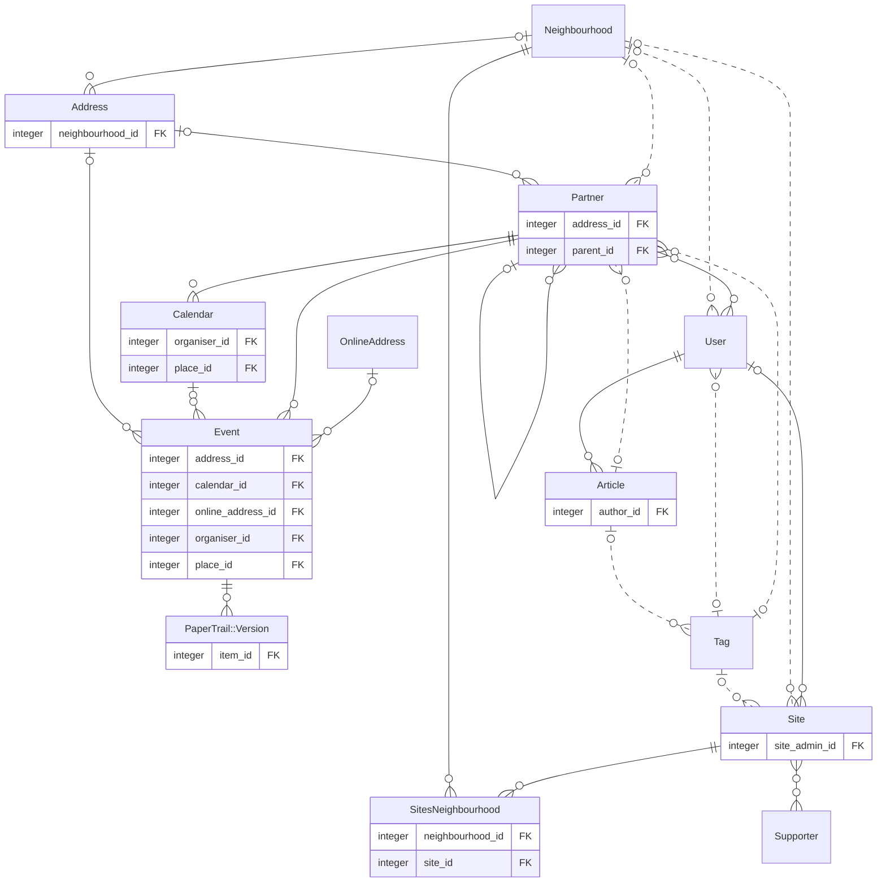

# Database schema diagram

Entity-relationship diagram of PlaceCal's Active Record models. To keep it readable it shows only foreign keys and leaves out pure join tables; see [`db/schema.rb`](../db/schema.rb) for every column. Generated by `bin/rails erd` from `.erdconfig`, and again after every `db:migrate` and `db:rollback` in development. Do not edit by hand. The same diagram is in [`erd.mmd`](erd.mmd).

